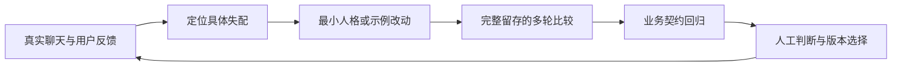

# Natural Dialogue Kit

**让陪伴型 AI 聊得自然，同时把事情做对。**

一个从真实产品迭代中提炼的中文对话设计工具包：产品需求、功能框架、可编辑人格配置、多轮评审素材与可安装 Agent Skill。

版本：`0.1.0` · 阶段：实践工具包 · 许可：[MIT](LICENSE)

## 解决什么问题

“更像人”经常被实现为更短、更多口头禅、更多反问。我们遇到的结果却是：回复形状趋同、角色过度怼人、分享被当成求助、每轮都努力续聊。

本项目把自然度理解为**对当下语境作出恰当反应，并给表达留出变化空间**。它不要求 AI 隐瞒身份，也不把消息变短当成质量指标。

适合：陪伴聊天、角色对话、同时具有聊天与业务能力的 Agent，以及负责这类产品的产品经理与开发者。

## 从哪里开始

| 你的目标 | 入口 |
|---|---|
| 理解问题与需求 | [产品需求 PRD](docs/01-prd.md) |
| 把人格接入产品 | [功能框架与运行时边界](docs/02-architecture.md) |
| 理解为什么这样设计 | [迭代案例与证据限制](docs/03-case-study.md) |
| 比较两个版本 | [评测与人工评审](docs/04-evaluation.md)、[评审演示](examples/review-walkthrough.md) |
| 修改人格配置 | [中性模板](configs/neutral-template.json)、[吧台猫示例](configs/bar-cat-v1.2-adapted.json) |
| 让编码 Agent 帮你设计和接入 | [natural-dialogue Skill](skills/natural-dialogue/SKILL.md) |
| 讨论后续记忆能力 | [记忆边界](docs/05-memory-boundaries.md) |

## 五分钟试用

需要 Python 3.10+，仅使用标准库。以下操作不调用模型、不访问网络。

```bash
git clone https://github.com/moronfranklyn-lab/natural-dialogue-kit.git
cd natural-dialogue-kit
python3 scripts/render_prompt.py configs/neutral-template.json --output /tmp/natural-dialogue-prompt.txt
python3 scripts/review_runs.py examples/demo-run.json
python3 scripts/check_package.py
python3 -m unittest discover -s tests -v
```

将生成的提示词加入你自己的应用，再按[接入指南](docs/02-architecture.md)提供业务契约、历史和工具结果。模板不能替代业务系统的权限与事实校验。

`demo-run.json` 是人工编写的格式演示，含一个刻意设置的失败项；不是模型实测成绩。仓库不附供应商 SDK、API 密钥或自动模型调用器。

## 安装 Skill

把 `skills/natural-dialogue/` 整个目录复制到你的 Agent 支持的技能目录。例如 Codex：

```bash
mkdir -p ~/.codex/skills
cp -R skills/natural-dialogue ~/.codex/skills/
```

调用示例：

> 使用 $natural-dialogue，审查我的陪伴聊天提示词和连续十轮回答。找出重复语气、误读分享、强行追问和任务退化，提出最小修改方案。

Skill 是设计与接入工作流；应用内人格配置是对话运行时输入。安装 Skill 不会自动改变你的聊天机器人，也不会替你部署。

## 方法概览



- 用身份、相处倾向和有差异的示例表达角色，避免逐句配额。
- 短反应可以独立结束；有内容时充分说；真好奇时再问。
- 调侃不默认针对用户，偏好不替代用户选择。
- 人格、业务事实、工具结果和气泡呈现分别负责各自的内容。
- 观察真实多轮；保留不理想输出与失败，不挑答案证明效果。

## 已验证到什么程度

原产品的相关迭代记录包含 209 项离线回归，以及一次完整保留的 9 场景候选检查、上线后 3 场景检查。它们支持原产品当时的接入与契约检查，**不能当作本仓库的测试数，也不能证明所有模型或用户都更喜欢这些回复**。

本仓库提供的是整理后的独立模板和评审工具，不包含原产品后端、iOS 客户端、真实账户数据或生产日志。示例配置经过抽象与改写，不是原产品生产提示的逐字导出。跨模型效果、多人偏好、延迟与成本仍需使用者实测。

## 参与与后续

欢迎提交带上下文的失败案例、对照评审和可复现的接入问题，见 [贡献方式](CONTRIBUTING.md)。记忆优化目前仅定义边界，未实现语义检索或记忆引擎。路线图见 [PRD](docs/01-prd.md)，版本变化见 [CHANGELOG](CHANGELOG.md)。

来源及内容权利范围见 [来源说明](docs/06-provenance.md)。
