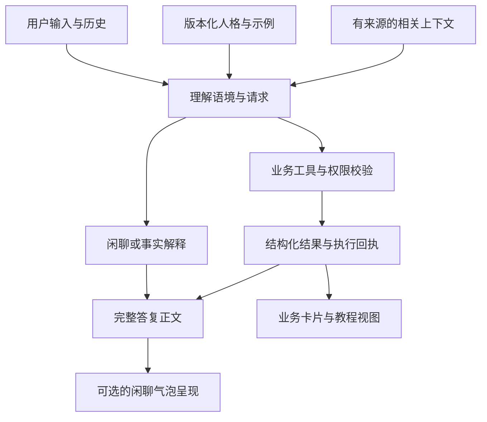

# 功能框架与运行时边界

## 模块划分



这是责任划分，不要求先调用一个意图分类模型，也不要求额外重写模型。可以由已有 Agent 循环完成。相关上下文不代表本仓库提供了记忆服务。

| 模块 | 输入 | 输出 | 不应承担 |
|---|---|---|---|
| 人格配置 | 身份、相处倾向、示例 | 默认表达风格 | 账户权限、真实库存、操作成功状态 |
| 业务执行 | 用户请求、授权、可信数据 | 结构化结果、错误、回执 | 为人设制造假成功 |
| 呈现层 | 完整正文、显示意图 | 气泡或长文视图 | 凭字数切碎业务字段 |
| 评审层 | 冻结版本、全部输出 | 偏好与缺陷记录 | 自动证明主观自然度 |

## 原产品中已采用的策略

核对实际主链后：人格身份和示例加载到业务 Agent；旧的聊天格式 register 不加载。事实解释可用完整段落、列表和编号。业务工具执行后使用业务提示；操作成功回执只准确说明结果。

闲聊最终答复以 `message` 为完整正文，`bubble_reply` 仅表达呈现意图。原产品只有在无工具调用、无操作结果、无来源/配方引用、无教程/卡片时，才允许派生聊天气泡。客户端呈现同一份内容，不让模型独立生成正文与另一套气泡文案。

这套保护来自原产品实现；本仓库提供设计和模板，没有复制其运行时。采用者需要实现自己的检查。

## 建议的最小接入

1. 先写清现有业务契约，再加入人格身份与示例；避免把完整技能说明塞进对话系统提示。
2. 使用 `scripts/render_prompt.py` 渲染配置；业务系统的权限、事实、工具契约先于表达风格。
3. 为本轮提供真实历史与可信工具结果，事实不足时说明不确定性。角色玩笑不写成用户经历或已执行操作。
4. 先生成一份完整正文。只有适合分条的闲聊才呈现为多条；不要强制固定条数。
5. 保存配置版本、渲染提示指纹、模型标识、输入历史、输出和错误，进行多轮评审及业务回归。

模板不包含供应商专用角色协议、鉴权或结构化输出 schema。它不能决定是否有权写数据库。

## 分段契约示意

```json
{
  "message": "没有
杯子自己少的",
  "bubble_reply": true
}
```

这是接口示意，不是本仓库已提供的 API。应用可从正文换行派生气泡；是否采纳必须由服务端结合结果类型检查。教程、推荐卡、错误详情和执行回执保留业务需要的结构。

## 版本与可追踪性

本工具包版本 `0.1.0` 与人格模板版本分别维护。渲染脚本输出配置原始字节 SHA-256 与渲染提示 SHA-256：前者追踪文件，包括空白变化；后者追踪实际渲染文本。真实运行还需记录基础业务提示、历史、模型参数与工具 schema；仅记录人格指纹不足以完整复现模型请求。

不固定具体模型或温度。对照评审时应保持非人格变量一致，并公开无法控制的变量。不得把渲染提示哈希当成线上完整系统提示哈希。
